# Capstone Project 6 · Resilient Container Platform & CI/CD

A small e-commerce backend ("Resilient Shop") on **Amazon ECS Fargate**, built to keep running when an Availability Zone fails, to absorb traffic spikes, and to deploy itself whenever code is merged to `main`. Everything is defined in CloudFormation in [`infrastructure/`](infrastructure/).

| Requirement | How it is met | Where |
|---|---|---|
| HA compute across ≥ 2 AZs | ECS Fargate services spread over 2 AZs behind an internet-facing ALB in both AZs | `01-core.yaml`, `02-services.yaml` |
| Resilient database | RDS PostgreSQL with **Multi-AZ** (synchronous standby), credentials managed by Secrets Manager | `01-core.yaml` |
| Caching | ElastiCache Redis replication group (primary + replica, Multi-AZ, automatic failover). The web app does cache-aside reads | `01-core.yaml`, `app/web/cache.js` |
| Asynchronous decoupling | `POST /orders` writes to RDS and enqueues to **SQS**. A separate worker service long-polls and processes. Failed messages go to a DLQ after 5 tries | `app/web/server.js`, `app/worker/worker.js` |
| Queue-driven scaling | Target tracking on **SQS backlog per running task** (metric math) for the worker; CPU and ALB requests per target for the web service | `02-services.yaml` |
| Automated backups | AWS Backup plan defined in IaC: daily RDS snapshot at 03:00 UTC, 7-day retention, in its own vault | `01-core.yaml` |
| DNS failover | Route 53 HTTP health check on the ALB, PRIMARY alias record to the ALB, SECONDARY to an S3 static maintenance page | `03-dr.yaml`, `infrastructure/failover-site/` |
| Serverless CI/CD | CodePipeline → CodeBuild (tests, builds **both** images, pushes to ECR) → ECS rolling deploy of both services, triggered automatically by commits to `main` | `04-pipeline.yaml`, `pipeline/buildspec.yml` |

---

## 1. Architecture

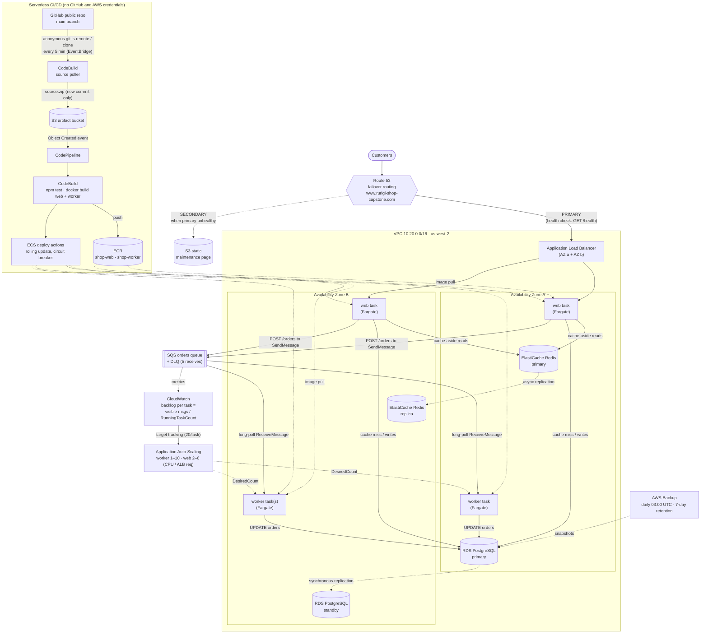

**End-to-end smoke test through the ALB.** The first `/products` call is answered by RDS (23 ms) and the second by Redis (1 ms). The two requests were served by tasks in **us-west-2b** and **us-west-2a**. The order placed is marked `PROCESSED` by a worker about 1 s later.

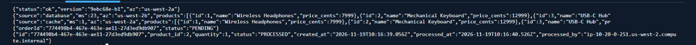

### Design decisions

- **No NAT gateway.** Fargate tasks run in the public subnets with public IPs. Their security group only accepts traffic from the ALB security group, so nothing on the internet can reach them directly. This removes the per-AZ NAT gateway, which would otherwise be either a single point of failure (one NAT) or the most expensive item in the bill (two NATs). RDS and Redis stay in private subnets with no route to the internet at all.
- **Liveness is separate from readiness.** `/health` only says "this container can serve". It deliberately does not check the database. If it did, a 30-second RDS failover would make every task fail its ALB health check at once, ECS would kill them all, and Route 53 would fail traffic over to the maintenance page for something the database recovers from on its own. `/status` reports the state of each dependency for operators.
- **The cache is never a dependency.** Every Redis call is wrapped so that if it fails, the read goes straight to RDS. If ElastiCache is lost, requests get slower but keep working.
- **Workers scale on backlog per task, not raw queue depth.** Queue depth alone doesn't fall when tasks are added, so target tracking on it keeps adding tasks. The policy uses metric math: `ApproximateNumberOfMessagesVisible ÷ RunningTaskCount` (Container Insights), with a target of 20 messages per task. That works out to about 20 s of acceptable lag at ~1 s per order.
- **Safe rolling deploys.** Both services run with `minimumHealthyPercent: 100`, `maximumPercent: 200` and the ECS **deployment circuit breaker with automatic rollback**. A bad image never reduces capacity and gets reverted automatically.
- **Workers shut down gracefully.** On SIGTERM (scale-in or deploy), the worker finishes the batch it is processing and then exits. Anything still unprocessed becomes visible on the queue again once the 120 s visibility timeout expires, so no order is lost.

### CI/CD without connecting GitHub to AWS

The brief says to connect CodePipeline to GitHub. The usual way is a CodeConnections (CodeStar) app installation, which gives AWS standing OAuth access to the GitHub account, or a GitHub Actions workflow holding AWS keys. I chose neither, so **no credential crosses between the two platforms**:

1. An EventBridge schedule runs a small CodeBuild project, `shop-source-poller`, every 5 minutes.
2. The poller runs `git ls-remote` against the **public** repo anonymously, the same way any visitor can, and compares the `main` SHA with the last one it handed off (stored in SSM Parameter Store).
3. If `main` has moved, it shallow-clones the repo, stamps `COMMIT_SHA`, and uploads `source/source.zip` to the versioned artifact bucket.
4. The S3 `Object Created` event starts **CodePipeline**: Source (S3) → Build (CodeBuild) → Deploy (ECS, web and worker in parallel).

The trade-off is up to 5 minutes before a merge triggers a deploy, in exchange for no OAuth grant and no long-lived keys to rotate or leak. Moving to CodeConnections later only means swapping the Source action.

---

## 2. CI/CD proof

Both pipeline runs below were started by the `shop-source-changed` EventBridge rule ("CloudWatchEvent" trigger), not by hand. Each one began when I pushed to `main`. The second run (`459ac4aa`) came from pushing commit `85a5d6d` while the services were live. It built both images, pushed them to ECR, and rolled **both** ECS services with no downtime.

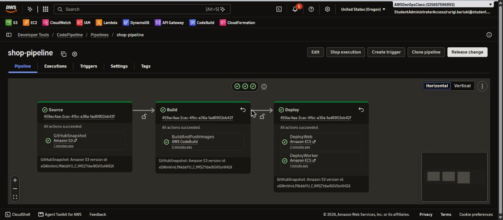

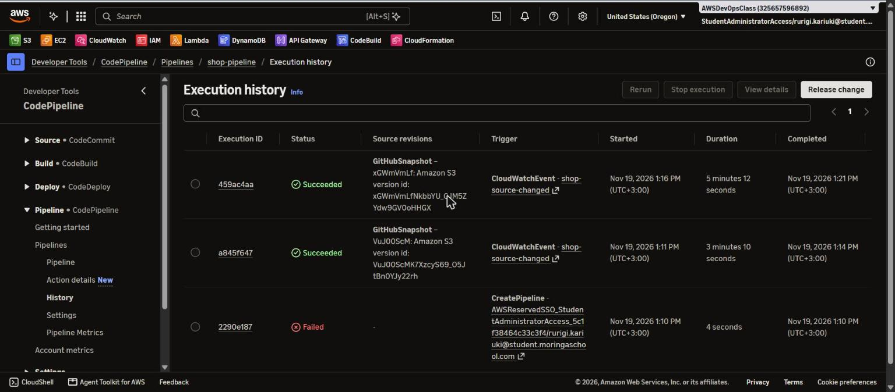

> The `Failed` run at the bottom is CodePipeline's automatic run when a pipeline is first created. It ran before the poller had uploaded any source, so `source.zip` didn't exist yet. It is expected and harmless.

What happens on each run (`pipeline/buildspec.yml`):

1. **Source:** the commit snapshot from S3. The poller stamps it with `COMMIT_SHA`.
2. **Build:** `npm install && npm test` for both apps (the build fails fast on broken code). Then `docker build` for web and worker, each tagged `<sha7>-b<build#>` plus `latest`, pushed to ECR (scan on push enabled). Finally it writes `imagedefinitions-web.json` and `imagedefinitions-worker.json`.
3. **Deploy:** two ECS deploy actions run in parallel. Each registers a new task definition revision and does a rolling update (100% minimum healthy, circuit breaker with rollback).

---

## 3. Scaling proof

**Test:** `./infrastructure/demo.sh load 4000` enqueued 4,000 orders through the web API (`POST /load`). Each worker processes about 1 order per second.

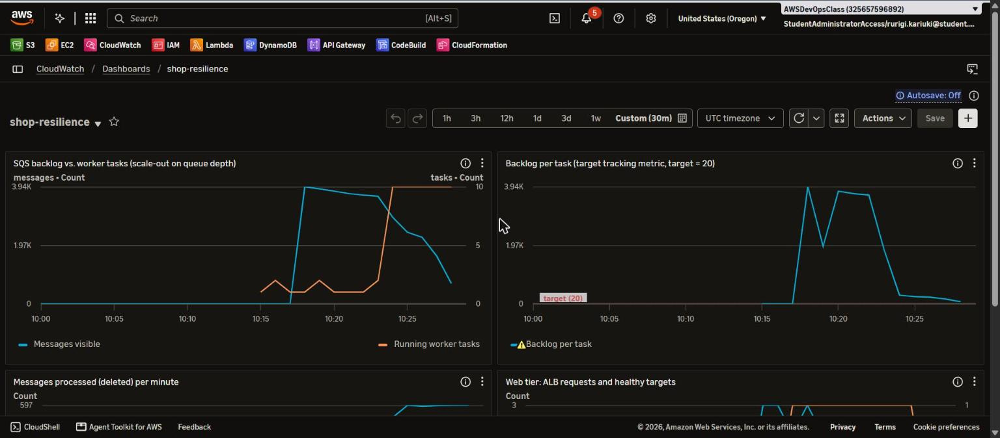

The `shop-resilience` dashboard is defined in `infrastructure/dashboard.json`.

- **Left:** at 10:17 the queue jumps to about 3,940 visible messages (blue). The worker service scales **from 1 to 10 tasks**, its configured maximum (orange). The queue then drains steadily.
- **Right:** the target-tracking metric itself, *backlog per task*, rises to about 3,900 and comes back towards the target of 20 as tasks are added and the queue drains.
- The brief 2-task bumps before the scale-out are the CodePipeline rolling deploy: ECS briefly runs the old and new task side by side.

Throughput rose from about 60 orders/min with 1 task to about **600 orders/min** with 10 tasks:

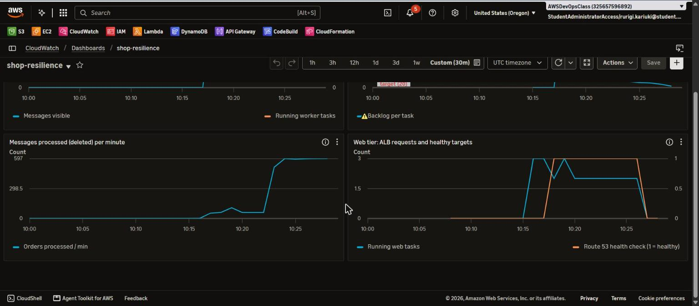

The same scale-out as seen from the CLI (`demo.sh watch`). The policy fired about 5 minutes after the burst, which is the target-tracking alarm needing 3 consecutive 1-minute datapoints, plus SQS metric delay:

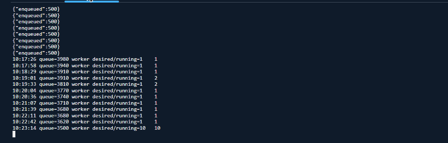

The web service scales separately on **CPU (50%)** and **ALB requests per target (200)**, with 2 to 6 tasks.

---

## 4. Disaster recovery

### 4.1 Backup plan

Defined in `01-core.yaml` (`AWS::Backup::BackupVault`, `BackupPlan`, `BackupSelection`, plus a dedicated IAM role):

| Setting | Value |
|---|---|
| Plan | `shop-daily` |
| Schedule | `cron(0 3 * * ? *)`: daily at 03:00 UTC (06:00 EAT), 1 h start window, 3 h completion window |
| Target | `shop-db` (RDS PostgreSQL Multi-AZ), selected by ARN |
| Vault | `shop-vault` |
| Retention | 7 days, then deleted automatically |
| Extra protection | RDS automated backups (PITR) also enabled; `DeletionPolicy: Snapshot` takes a final snapshot if the stack is deleted |

To prove the plan works without waiting for 03:00, I ran an on-demand job with the same vault and role (`demo.sh backup-now`). It **completed** and produced an RDS snapshot recovery point:

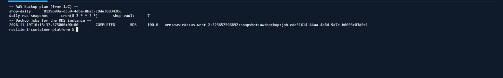

### 4.2 Failover test

**Scenario:** the whole container cluster goes offline. Simulated by forcing the web service's auto scaling range to 0 and setting the desired count to 0 (`demo.sh fail`). The domain `rurigi-shop-capstone.com` exists only as a Route 53 hosted zone and isn't registered, so DNS answers are read straight from Route 53 with `aws route53 test-dns-answer`. That's the same answer its name servers give resolvers.

**1. Before (10:26:12 UTC):** health checkers in 3 regions get HTTP 200 from the ALB. Route 53 answers with the **ALB's IPs** (`44.252.134.143`, `32.185.91.70`).

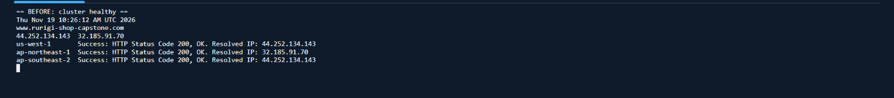

**2. Outage injected (10:26:32):** the web service goes to 0 tasks. The ALB starts returning 503, and the health check flips to **Failure** at 10:27:31, about 60 s later.

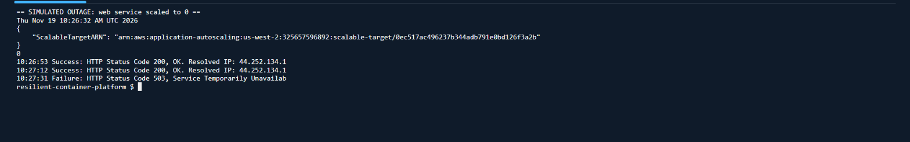

**3. Failover (10:28:13):** Route 53 now answers with **S3 website endpoint IPs** (`52.92.x.x`, `52.218.x.x`, `16.15.x.x`), the SECONDARY record. Users get the static "We'll be right back" page instead of an error.

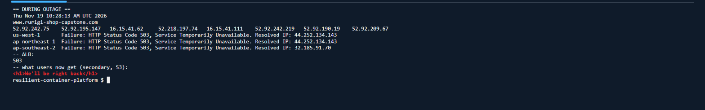

**4. Failback (10:30:53):** the service is restored to 2 tasks and is stable by 10:30:07. All checkers report 200 again, and Route 53 automatically returns to the ALB IPs. No manual DNS change was needed in either direction.

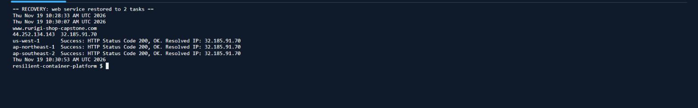

| Measure | Result |
|---|---|
| Outage start → health check failing | ~60 s (10 s interval × 2 failures, plus propagation across checker regions) |
| Outage start → DNS answering with S3 page | < 2 min |
| Service restored → DNS back on ALB | < 1 min |
| Orders lost | 0. Orders already queued stay in SQS, and workers kept processing throughout the web outage |

The bottom-right panel of the CloudWatch dashboard (above) shows the same event: running web tasks drop to 0 and the Route 53 health check status goes from 1 to 0 at about 10:27.

### 4.3 DR runbook

| # | Failure | Detection | Automatic response | Operator action |
|---|---|---|---|---|
| 1 | **One web/worker task crashes** | ALB target health / ECS task state | ECS replaces the task. The ALB stops routing to it within ~30 s | None |
| 2 | **An Availability Zone fails** | ALB health checks, ECS | The ALB routes only to the healthy AZ. ECS starts replacement tasks in the remaining AZ. **RDS** promotes the standby (~60–120 s, same endpoint DNS). **ElastiCache** promotes the replica | None. The app retries DB connections, and cache misses fall back to RDS |
| 3 | **RDS primary failure** | RDS event `RDS-EVENT-0049` | Multi-AZ failover to the standby. The endpoint name doesn't change | Check `/status` reports `db:true`. Test with `aws rds reboot-db-instance --db-instance-identifier shop-db --force-failover` |
| 4 | **Whole cluster / ALB unavailable** | Route 53 health check → alarm `shop-primary-unhealthy` | DNS fails over to the S3 maintenance page in under 2 min | Find the cause (ECS events, `/ecs/shop-web` logs, last pipeline run). If a bad deploy got past the circuit breaker, roll back with `aws ecs update-service --task-definition <previous revision>`. DNS fails back by itself |
| 5 | **Bad release** | ECS deployment circuit breaker | Automatic rollback to the last working task definition. Capacity never drops below 100% | Fix forward with a new commit to `main` |
| 6 | **Queue backlog / workers failing** | Backlog-per-task metric, DLQ depth | Workers scale out up to 10. Messages failing 5 times go to `shop-orders-dlq` | Inspect the DLQ, fix, then redrive with `aws sqs start-message-move-task` |
| 7 | **Data corruption / accidental delete** | Manual / application errors | None, since replication copies the corruption too. That's what backups are for | Restore the latest good recovery point from `shop-vault` (`aws backup start-restore-job`) or use RDS point-in-time restore to a new instance. Point the stack's `DB_HOST` at it, verify, then cut over. **RPO:** ≤ 24 h from AWS Backup, ~5 min with PITR. **RTO:** ~20–30 min (restore + redeploy) |

**Commands used for the tests:** `./infrastructure/demo.sh fail`, `dns`, `recover`, `backup-now`.

---

## 5. Repository layout

```
app/
  web/        Express API: products (Redis cache-aside over RDS), orders → SQS, /health, /status, /load
  worker/     SQS long-poll consumer that processes orders and updates RDS
pipeline/
  buildspec.yml        CodeBuild: test, build + push web and worker images, emit imagedefinitions
infrastructure/
  01-core.yaml         VPC, ALB, ECS cluster, ECR, RDS Multi-AZ, ElastiCache, SQS + DLQ, AWS Backup
  02-services.yaml     Fargate task definitions, services, auto scaling policies, IAM task roles
  03-dr.yaml           Route 53 hosted zone, health check, failover records, S3 maintenance site
  04-pipeline.yaml     Source poller, CodeBuild, CodePipeline, EventBridge triggers
  deploy.sh            Ordered deploy / teardown helper
  failover-site/       Static maintenance page
docs/                  Diagram and evidence screenshots
```

## 6. Deploying it yourself

From AWS CloudShell in the target region:

```bash
git clone https://github.com/RURIGIMK/resilient-container-platform.git && cd resilient-container-platform
./infrastructure/deploy.sh core       # ~15 min, mostly RDS Multi-AZ + ElastiCache
./infrastructure/deploy.sh services   # services created at 0 tasks: no image exists yet
./infrastructure/deploy.sh pipeline   # starts the poller → first pipeline run builds + pushes images
./infrastructure/deploy.sh scale-up   # after the first green run: web 2 tasks, worker 1
./infrastructure/deploy.sh dr         # Route 53 failover + S3 maintenance page
./infrastructure/deploy.sh destroy    # tear down in reverse order (RDS keeps a final snapshot)
```

## 7. Cost and clean-up

While running, the stack costs about **$0.20 an hour**. Most of that is RDS Multi-AZ (db.t3.micro), 2 Redis nodes, the ALB and 3 small Fargate tasks. The source poller adds about 1 CodeBuild minute every 5 minutes. To stop all charges, run `./infrastructure/deploy.sh destroy`. Before that, disable the `shop-source-poll` rule if you want to keep the stacks but stop the polling.
